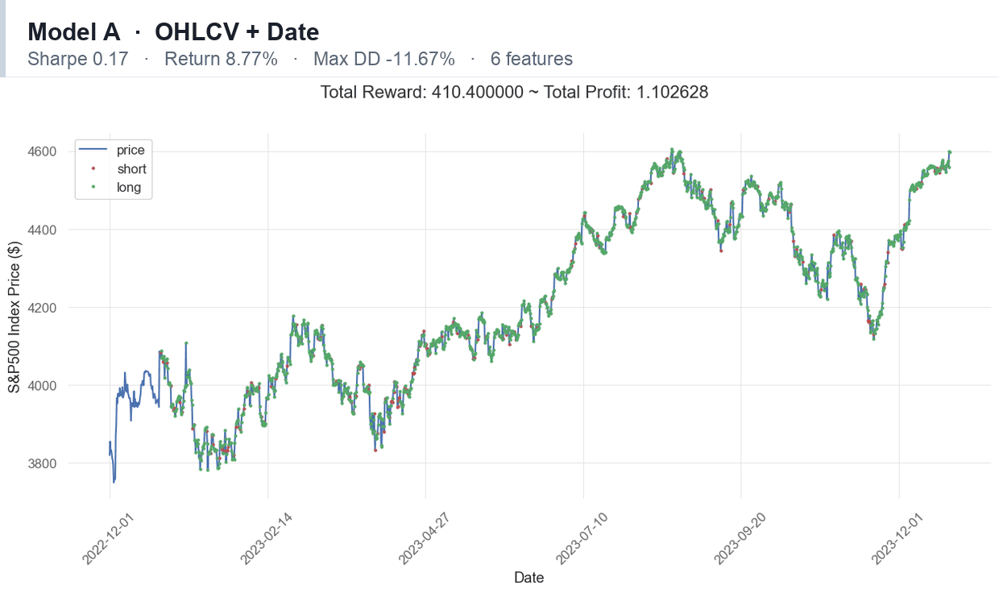

# Deep Reinforcement Learning for Algorithmic Trading

Does news sentiment actually help a reinforcement learning trading agent, or does
market structure carry the signal on its own?

This repository holds the code and results for my MSc Data Analytics dissertation
(University of Sheffield, awarded with Distinction). A PPO agent trades S&P 500
four-hour bars across four feature sets, from raw price data up to price plus a custom
market structure indicator plus FNSPID news sentiment. The point was to isolate what
each group of features is worth.



## Results

Backtest window 2022-12-01 to 2023-12-01, S&P 500 four-hour bars, PPO with a
[128, 64, 32] policy network.

| Model | Features | Signals | Return | CAGR | Sharpe | Sortino | Max DD | Time in market |
|-------|----------|--------:|-------:|-----:|-------:|--------:|-------:|---------------:|
| A | OHLCV + Delta | 6 | 8.77% | 5.97% | 0.17 | 0.23 | -11.67% | 24% |
| **B** | **+ Market Structure** | **10** | **9.71%** | **6.61%** | **0.20** | **0.26** | **-9.84%** | **15%** |
| C | + News sentiment | 14 | 8.81% | 6.00% | 0.17 | 0.23 | -12.19% | 37% |
| D | + Market Structure + sentiment | 18 | 8.46% | 5.76% | 0.17 | 0.23 | -11.71% | 27% |
| Buy and hold | n/a | n/a | 11.83% | n/a | n/a | n/a | n/a | 100% |

Three things worth saying plainly:

1. **Buy and hold beat every agent on raw return.** Over this window the index
   returned 11.83% and the best agent returned 9.71%. Any honest reading starts there.
2. **The interesting part is the exposure.** Model B reached 82% of the buy and hold
   return while holding a position only 15% of the time, with a -9.84% maximum
   drawdown. That is a different risk profile, not a worse version of the same one.
3. **Sentiment did not help.** Adding FNSPID news sentiment (Model C) moved Sharpe
   not at all and made drawdown worse. Stacking it on top of market structure
   (Model D) was the weakest configuration of the four. The custom market structure
   indicator was the only feature group that improved risk adjusted return.

A separate comparison of policy architectures on a shorter training run gave a mean
episode reward of 72.4 for [128, 64, 32] against 65.8 for [128, 128, 128], so the
smaller network was used throughout.

## What is in here

| File | Purpose |
|------|---------|
| `Dissertation_Notebook.ipynb` | Feature engineering for the four datasets, the custom Gym environment, PPO training, TensorBoard metric extraction, evaluation and equity curves |
| `SentimentAnalysis.ipynb` | Sentiment extraction and scoring over the FNSPID financial news corpus |
| `docs/results.gif` | The figure at the top of this page |

The market structure indicator is the custom piece. It identifies breaks of
structure and labels the most recent swing high and low, then expresses the current
price as a signed percentage of that range, so the agent sees where price sits inside
the current leg rather than a raw level.

## Running it

```bash
python -m venv .venv && source .venv/bin/activate   # Windows: .venv\Scripts\activate
pip install -r requirements.txt
jupyter lab
```

Two things you need to supply yourself:

- **Price and news data.** Neither is redistributable here. The notebooks expect
  four-hour OHLCV bars indexed by timestamp (OANDA SPX500USD, 240 minute), and the FNSPID news corpus for the
  sentiment notebook.
- **The `Trading` helper module.** `Dissertation_Notebook.ipynb` imports a local
  module named `Trading` that provides `identify_breaks`, `determine_trend`,
  `calculate_distance` and `plot_candlestick`. It is not included in this
  repository, so the market structure cells will not run as published.

Paths are set once near the top of each notebook via `DATA_DIR`, `MODEL_DIR` and
`LOG_DIR` rather than being hardcoded, and can be overridden with the
`DRL_DATA_DIR`, `DRL_MODEL_DIR` and `DRL_LOG_DIR` environment variables.

`SentimentAnalysis.ipynb` calls a hosted LLM for sentiment scoring and reads its
credential from the environment:

```bash
export GROQ_API_KEY=your_key_here
```

## Method

1. Build four datasets from the same four-hour bars: raw OHLCV plus Delta, then
   progressively add the market structure features and the sentiment scores.
2. Wrap each dataset in a custom Gym environment extending `gym-anytrading`, with a
   100 bar observation window and a discrete long/short action space.
3. Train PPO from `stable-baselines3` on each dataset, logging to TensorBoard.
4. Evaluate on a held out window and generate equity curves and QuantStats tearsheets.

## Stack

Python, PyTorch, stable-baselines3 (PPO), Gym and gym-anytrading, pandas, NumPy,
scikit-learn, QuantStats, Matplotlib, Seaborn, TensorBoard.
